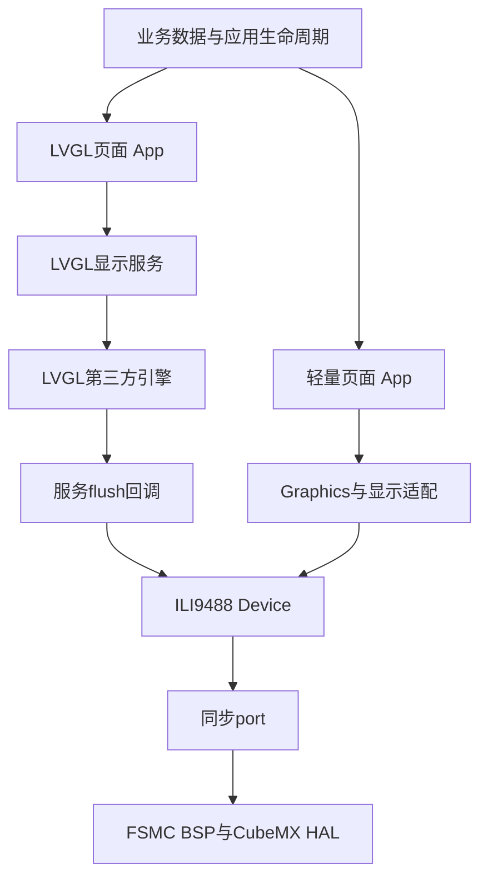

# 显示单元双方案设计

2026-11-13。按stm32-architecture-c选择design / production / standard。用户需求为带LVGL与纯裸机两套方案，本文将后者定义为裸机主循环调度的轻量Graphics版本，LVGL版本同样支持裸机主循环。

## 方案边界

采用编译时选择，同一个固件为同一块屏幕选择一套绘制路径。公用ILI9488 Device、FSMC BSP、port及面板参数。当前使用旧Demo候选参数，实板确认状态见板级说明。

| 内容 | LVGL方案 | 轻量裸机方案 |
|---|---|---|
| 源码清单 | lvgl-sources.txt | baremetal-sources.txt |
| 上层渲染 | LVGL标签、控件、页面 | Graphics字体、字符串、固定字段 |
| 现有入口 | SVC_LVGL_Start/Process/Resume/Stop | GFX_ILI9488_DrawString/DrawTextField |
| 现有演示 | APP_LVGL_Demo两页数字和状态 | 由应用定义坐标和字段宽度 |
| 文本变短 | LVGL重绘旧区域 | DrawTextField补背景空格 |
| 内存 | 19200字节像素缓冲及48KiB池，另计栈和全局 | 最大32字节像素行暂存及64字节字段暂存，另计栈和全局 |
| 字库 | Montserrat14 ASCII | 旧Demo8×16 ASCII点阵 |
| 调度 | 主循环或唯一显示任务周期调用 | 主循环检测数据变化后同步绘制 |
| 分配 | LVGL固定池中动态分配对象 | 绘图路径使用自动和静态存储 |

上表为现有实现能力。两套方案均由应用决定背光、启动/关闭和恢复策略。中文、触摸和运行时更换渲染后端需按产品需求增加。

## 分层和归属



应用是整个显示单元的生命周期所有者，Device持有控制器状态和方向，BSP提供写总线，port绑定时基与就绪能力。LVGL服务持有引擎和像素缓冲，App持有页面对象。轻量页面持有字段坐标、数据副本及待刷新标志。

当前显示Services适配层直接消费Device绘图能力，以复用器件窗口、超时和故障诊断。该依赖明确限定于显示适配，业务逻辑通过App数据接口组织。Module/Graphics保持硬件无关。

现阶段保留两套现有API。产品业务快照的字段取决于实际系统数据，产品接入时在App定义该快照，再由选择的页面渲染。当前DemoSetValue属于示例接口。新增统一业务服务时应一起实现两套后端并验证，避免在设计文档中把拟定API当作现有接口。

## 配置与构建

baremetal-sources.txt包含8个生产C文件。包含目录为User/Device/ILI9488、User/BSP、User/BSP/Ports、User/Module/Graphics和User/Services/Display。该清单可独立使用，源码依赖不引用LVGL。

lvgl-sources.txt包含固定版本LVGL及显示服务、示例App和公共底层。包含目录与LV_CONF_INCLUDE_SIMPLE定义沿用lvgl-integration.md。只有选择此方案的目标需要初始化LVGL子模块。

在实际工程中建立两个可选target，分别使用上述清单和包含目录。目标名称由目标工程约定。若宿主已有配置宏，可将选择保存在User/Config中并控制工程源码参与。当前独立模板通过清单表达选择，两套完整文件系统副本容易产生底层修复不同步。

面板参数由Device配置权威来源统一管理，GPIO/FSMC静态参数由CubeMX与BSP管理，页面颜色、坐标、字段宽度和刷新周期由App管理。

## 共用启动前提

宿主完成供电/物理复位、时钟、GPIO/FSMC和持续毫秒时基，建立port，通过InitState绑定Device并Open成功。共享NRST及背光固定供电限制见board-puzhong-qilin-f407.md。应用检查每一步返回值，显示失败应留给系统决定告警或降级策略。

所有显示调用来自同一个主循环或任务。ISR记录采样数据或事件，再由应用转交显示。RTOS下可将最新业务快照复制给显示任务，数据快照更新与GUI对象操作分别在所属上下文执行。

## 轻量裸机运行流程

1. Device进入READY后，应用清屏并绘制固定标题、框线或静态色块。
2. 应用为每个可变字段确定坐标、字符数和前景背景色。每次更新使用相同字段区域。
3. 主循环采集业务数据，比较已成功显示的数据。发生变化时格式化为有界ASCII字符串，调用DrawTextField。
4. 仅绘制成功后提交已显示数据副本并清除待刷新标志。失败保留该标志，恢复后重新绘制。
5. 以产品允许的频率更新，例如参数页可先用100ms周期作为调试起点。该周期为应用策略，最终由业务时效和实测阻塞时间确定。

```c
/* 放在已完成Device启动的应用函数内。now回调签名为uint32_t (*)(void*)。 */
GFX_TextStyle style = {0xFFFFU, 0x0000U, true, false};
GFX_Status result = GFX_ILI9488_DrawTextField(
    8, 32, "12345", 5U, 8U, &style, now, 100U);
/* 后续同一字段更新，8字符区域整体覆盖。 */
result = GFX_ILI9488_DrawTextField(
    8, 32, "12", 2U, 8U, &style, now, 100U);
```

DrawTextField支持1..64个字符，但整段必须位于屏幕内。8×16字形在横屏宽480时最多60列，纵屏宽320时最多40列，还需扣除起始x。长文本或换行直接拒绝。DrawString适合自由排版，其尾部擦除由页面安排。

每次图形调用有总时间预算。页面由多次绘图调用组成时，页面拥有者应按页面起始时刻计算剩余预算，避免每个字段重新获得完整页面时间额度。同步绘图不能被软件预算强制抢占，需测量最大阻塞时间。

## LVGL运行流程

1. Device READY后调用SVC_LVGL_Start，继而创建App页面。
2. 主循环更新业务数据，在同一上下文调用DemoSetValue或产品页面接口。
3. 以1..5ms服务间隔作为现有建议调用Process，默认33ms刷新周期由lv_conf.h控制。更新频率受实际任务预算和界面复杂度约束。
4. LVGL生成局部像素区域，服务flush通过BlitRect同步输出。应用收到Process错误后进入恢复流程。
5. 页面切换使用DemoShowPage或产品页面接口。当前演示通过应用选择页面。

LVGL tick使用与Device port同源的持续毫秒回调。Start与Process的clock回调签名为uint32_t (*)(void)，与轻量适配的context版本分别在宿主封装。

## 故障、休眠及方向变化

| 操作 | 轻量裸机方案 | LVGL方案 |
|---|---|---|
| 发送失败 | 页面保留待刷新标志，查询Device诊断 | 服务保留首个故障并暂停，应用查询错误 |
| 器件FAULT | 应用显式Recover | 应用显式Recover后Resume |
| 仅刷新预算超时且Device READY | 应用安排字段重绘 | 应用可Resume整屏重绘 |
| 恢复成功 | 重绘静态页面和全部字段 | Resume使活动屏幕失效 |
| 进入睡眠 | 停止页面绘制，再Sleep | 销毁页面、Stop服务，再Sleep |
| 唤醒 | Wake后清屏并完整重绘 | Wake、Start、重新创建页面 |
| 改变方向 | SetRotation成功后重新计算布局并重绘 | 销毁页面、Stop、SetRotation、Start、创建页面 |
| 关闭 | 应用停止刷新，再Close | 销毁页面、Stop，再Close |

恢复与睡眠都不能假定GRAM内容保留。背光状态由具体板级能力确定。当前图示模组为固定供电背光。

## 验证与交付边界

当前已有底层和两种渲染接口代码，本文完成双方案设计和可选源码清单。轻量版的产品页面、数据快照及刷新管理器仍需按实际业务字段实现。现有LVGL两页为可运行示例，实际工程target与完整固件链接在工程集成阶段验证。

双方案验收需要分别检查源码参与和依赖、实板颜色与四方向、12345变12的尾部清理、空文本清空、超长拒绝、故障后重绘、睡眠唤醒和最大阻塞时间。LVGL还需检查动态池与栈余量。主机及ARM对象编译历史证据见validation.md，实板证据尚待取得。
